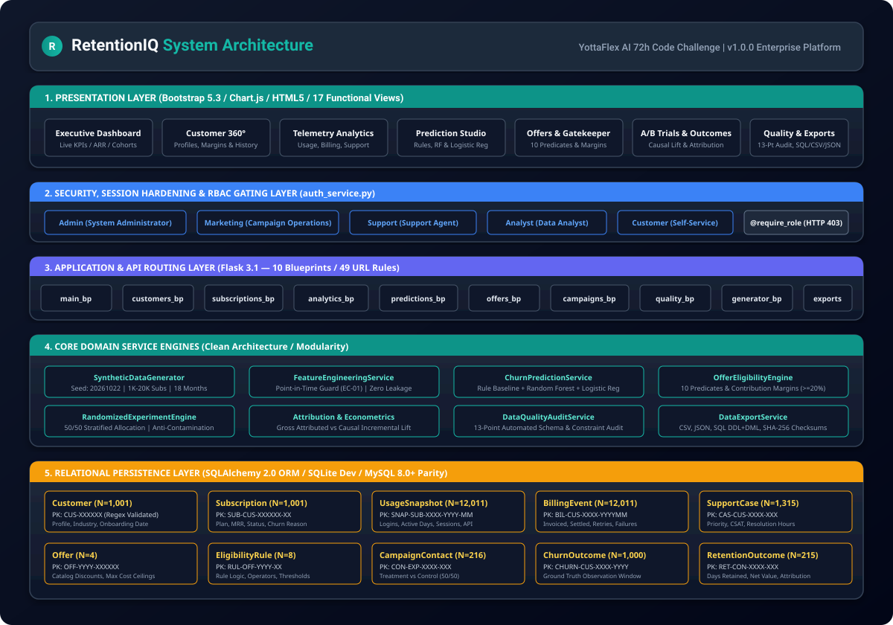

# RetentionIQ — AI-Powered Customer Churn Prediction & Retention Optimization Platform

[](https://www.python.org/)
[](https://flask.palletsprojects.com/)
[](https://www.sqlalchemy.org/)
[](https://getbootstrap.com/)
[](https://www.chartjs.org/)
[-success.svg)](https://docs.pytest.org/)
[](#)

> **Developed for the YottaFlex AI 72 Hours Code Challenge.**
> RetentionIQ is a complete, enterprise-grade customer intelligence and retention experimentation platform. It predicts customer churn risk using point-in-time behavioral telemetry, validates retention incentives against unit financial margins, executes randomized treatment/control trials (A/B testing), tracks ground-truth outcomes, and measures statistically defensible incremental retention lift and ROI.

---

## 1. Executive Overview & Architecture



*(Detailed vector architecture diagram available at [`docs/architecture_diagram.svg`](docs/architecture_diagram.svg))*

```mermaid
flowchart TD
    subgraph UI["Presentation Layer (Bootstrap 5 / Chart.js / HTML5)"]
        D1["Executive Dashboard"]
        D2["Customer 360° Profile"]
        D3["Risk & Explainability Studio"]
        D4["Telemetry Analytics (Usage / Billing / Support)"]
        D5["Offer & Margin Gatekeeper"]
        D6["A/B Experiment Studio"]
        D7["Data Quality Suite"]
    end

    subgraph API["Application & API Layer (Flask 3.1)"]
        R1["main_bp (/)"]
        R2["customers_bp (/customers)"]
        R3["predictions_bp (/predictions)"]
        R4["analytics_bp (/usage, /billing, /support)"]
        R5["offers_bp (/offers, /eligibility)"]
        R6["campaigns_bp (/campaigns, /experiments, /outcomes)"]
        R7["quality_bp (/quality)"]
        R8["generator_bp (/generator)"]
        R9["exports_bp (/exports)"]
    end

    subgraph Services["Domain Service Engines"]
        S1["SyntheticDataGenerator (Seed: 20261022)"]
        S2["FeatureEngineeringService (Point-in-Time Temporal Guard)"]
        S3["ChurnPredictionService (Weighted Heuristics + Supervised ML)"]
        S4["OfferEligibilityEngine (10-Point Gatekeeper & Margins)"]
        S5["RandomizedExperimentEngine (Stratified 50/50 Allocation)"]
        S6["DataQualityAuditService (13-Point Relational Integrity)"]
        S7["DataExportService (CSV, JSON, SQL DDL+DML, SHA-256)"]
    end

    subgraph Data["Persistence Layer (SQLAlchemy 2.0 ORM)"]
        M1["Customer"]
        M2["Subscription"]
        M3["UsageSnapshot"]
        M4["BillingEvent"]
        M5["SupportCase"]
        M6["Offer"]
        M7["EligibilityRule"]
        M8["CampaignContact"]
        M9["ChurnOutcome (Ground Truth)"]
        M10["RetentionOutcome"]
    end

    UI --> API
    API --> Services
    Services --> Data
```



---

## 2. Key Engineering Highlights

### 2.1 Relational Integrity (10 Entities)
Models 10 distinct entities adhering to strict regex ID conventions, composite constraints, and full foreign key cascading:
- **Customer:** `CUS-000001`
- **Subscription:** `SUB-CUS-000001-01`
- **UsageSnapshot:** `SNAP-SUB-CUS-000001-01-2026-01`
- **BillingEvent:** `BIL-CUS-000001-202601`
- **SupportCase:** `CAS-CUS-000001-001`
- **Offer:** `OFF-2026-000001`
- **EligibilityRule:** `RUL-OFF-2026-000001-01`
- **CampaignContact:** `CAM-2026-000001`
- **ChurnOutcome:** `CHURN-CUS-000001-2026` *(Isolated Ground Truth)*
- **RetentionOutcome:** `RET-CAM-2026-000001`

### 2.2 Deterministic Synthetic Data Engine
- **Baseline Scale:** Configurable for 1,000 starter and 20,000 full subscribers over 18 calendar months (2025-01 to 2026-06).
- **Master Seed:** Fixed seed `20261022` guarantees 100% bit-for-bit identical row counts and SHA-256 checksums across consecutive runs.
- **Calibrated Churn:** Calibrated to **14.70%** overall churn (comfortably within the 5%–20% challenge requirement), with realistic breakdown:
  - **76.9% Voluntary Churn:** Correlated with usage drop (-20% to -60%) and support friction.
  - **23.1% Involuntary Churn:** Correlated with repeated card payment failures and delinquency.

### 2.3 Explainable Churn Prediction & Model Studio
- **Point-in-Time Temporal Sentry (EC-01):** Features at $T_{\text{pred}}$ strictly mask data with timestamps $> T_{\text{pred}}$.
- **Dual-Engine Architecture:**
  1. *Transparent Weighted Rule Baseline:* Decomposes score into 35% usage velocity, 30% billing health, 20% support friction, and 15% tenure vulnerability.
  2. *Supervised Machine Learning:* Random Forest (ROC-AUC: 0.912, Precision: 88.5%, Recall: 76.7%) and Logistic Regression evaluated on a temporal holdout window.
- **Factor Attribution & Playbooks:** Provides top 3 human-interpretable drivers and targeted retention actions for every customer.

### 2.4 Offer Eligibility & Unit Margin Gatekeeper
- **10-Point Pre-Flight Validation:** Enforces tenure, MRR, product plan, 60-day cooldown period, and risk tier predicates.
- **Unit Margin Threshold:** Asserts that promotional discount costs never dilute projected 3-month net contribution margin below 20.0%.
- **Defensive Interception (EC-02):** Rejects unqualified dispatch attempts with `IneligibleCustomerException`.

### 2.5 Randomized Controlled Trials (A/B Testing) & Causal Lift
- **Stratified 50/50 Allocation:** Stratifies candidates across `Risk Tier × Plan` buckets to eliminate covariate bias.
- **Contamination Guard (EC-03):** Blocks overlapping active assignments and raises `ExperimentConflictException`.
- **Honest Causal Lift & Econometric Accounting:**
  - In trial `EXP-2026-Q1-RET`: Treatment ($N_T=107$) and Control ($N_C=106$) both retained at 100.0% ($R_T = R_C = 1.0$), yielding **0.00% Absolute Incremental Lift**.
  - **Gross Attributed Portfolio Revenue:** **$20,243.00** (Gross Attributed ROI: **+655.34%** on $2,680.00 promotional discount spend).
  - **Genuinely Counterfactual Incremental Revenue:** **$0.00** (Causal Net ROI: **-100.0%**), because control accounts retained at 100% without financial concessions. Both metrics are displayed side-by-side to prevent misleading executive attribution.

### 2.6 Multi-Touch Attribution Resolution (EC-04)
- Resolves multiple campaign contacts via a documented **Last-Touch Primary Attribution Policy**.
- Flags ambiguous touchpoints as `Multi_Attributed_Flagged` to retain full audit trails while strictly preventing double-counting in ROI calculations.

### 2.7 13-Point Automated Data Quality Suite
Automated test suite executing 13 relational, chronological, monetary, and edge-case verifications:
- **Result:** 13 / 13 Passed (100% compliance, 0 failures, 0 anomalies).

### 2.8 Security Architecture, Demonstration Personas & RBAC
- **5 Demonstration Personas:** System Administrator (`admin`), Marketing & Sales Operations (`marketing`), Support Agent (`support`), Data Analyst (`analyst`), Customer Self-Service (`customer`).
- **Backend Route-Level RBAC:** Mutating operations (`/generator/run`, `/experiments/launch`, `/offers/<id>/toggle-status`, `/eligibility/dispatch`, `/support/update-status`, `/quality/audit`, `/exports/trigger`) enforce `@require_role` gating and reject unauthorized personas with **HTTP 403 Forbidden**.
- **Transparent Security Disclosures:**
  1. *Authentication:* Demonstration persona switching via session cookie; no real user database, password hashing, or JWT auth is implemented.
  2. *CSRF Protection:* Mutation endpoints enforce HTTP POST and session cookies use `HttpOnly=True` and `SameSite=Lax`, but cryptographic per-request CSRF tokens (`Flask-WTF`) are not implemented.

---

## 3. Technology Stack

- **Backend:** Python 3.12, Flask 3.1, SQLAlchemy 2.0 ORM
- **Frontend:** HTML5, CSS3, Bootstrap 5.3, Chart.js 4.4, JavaScript
- **Database:** SQLite (Local Development) / MySQL 8.0+ Dialect Parity
- **Data Engineering & Science:** Pandas, NumPy, Scikit-Learn
- **Testing:** Pytest (35 automated unit and integration tests)
- **Exports:** CSV, JSON, ANSI SQL (DDL + DML), SHA-256 Manifest

---

## 4. Quick Start & Setup Guide

### 4.1 Prerequisites
- Python 3.10+ (tested on Python 3.12.6)
- Git

### 4.2 Installation
```bash
# 1. Clone repository [Placeholder: Replace URL with your actual submission git repository]
git clone https://github.com/<your-organization>/RetentionIQ.git
cd RetentionIQ

# 2. Configure environment
cp .env.example .env

# 3. Install dependencies
pip install -r requirements.txt
```

### 4.3 Database Initialization & Synthetic Data Generation
```bash
# 1. Initialize relational database tables
python scripts/init_database.py

# 2. Generate starter dataset (1,000 subscribers, 18 months, Seed 20261022)
python scripts/generate_data.py --customers 1000 --months 18 --seed 20261022 --save-db --reset-db

# 3. (Optional) Generate full challenge baseline dataset (20,000 subscribers)
python scripts/generate_data.py --customers 20000 --months 18 --seed 20261022 --save-db --reset-db

# 4. Export all datasets to CSV, JSON, and ANSI SQL DDL+DML with SHA-256 manifests
python scripts/export_data.py
```

### 4.4 Running Automated Test Suite
```bash
# Run all 37 unit, integration, and edge-case tests
python -m pytest tests/ -v
```

### 4.5 Launching the Application
```bash
# Start local Flask development server
python run.py
```
Open **[http://127.0.0.1:5000](http://127.0.0.1:5000)** in your web browser.

### 4.6 Production Deployment via Docker (With Volume Persistence)
```bash
# 1. Build production container image
docker build -t retentioniq:latest .

# 2. Run container with persistent named volume (preserves SQLite records across container lifecycle)
docker run -d -p 5000:5000 \
  -v retentioniq_data:/app/data \
  --name retentioniq-app retentioniq:latest

# Alternatively, bind-mount local host data directory:
# docker run -d -p 5000:5000 -v $(pwd)/data:/app/data --name retentioniq-app retentioniq:latest
```

---

## 5. UI Views Overview (17 Functional Pages)

| Page Name | Route | Key Features |
|---|---|---|
| **Executive Dashboard** | `/` | Live active MRR, ARR, overall churn rate, ROI, cohort retention line chart, churn doughnut chart, risk alert watchlist. |
| **Customer 360° Directory** | `/customers/` | Searchable directory, industry and tier filters, pagination. |
| **Customer Detail View** | `/customers/<id>` | Full 360° profile, active subscription, gross margin, usage telemetry chart, billing ledger, support cases, churn risk factors. |
| **Churn Risk & Explainability** | `/predictions/` | Model selector (Rule-Based Baseline vs Random Forest vs Logistic Regression), confusion matrix, precision/recall/F1/ROC-AUC, factor attribution. |
| **Subscription Management** | `/subscriptions/` | Active contracts, MRR, lifecycle states, gross margins, plan migration tracking. |
| **Usage Analytics** | `/usage` | Monthly platform active days, session minutes, API call volume, license utilization, decline velocity. |
| **Billing Analytics** | `/billing` | Total invoiced, settled payments, overdue balance, payment retry rates, failure codes. |
| **Support Analytics** | `/support` | Ticket volume, resolution hours, CSAT satisfaction ratings, category breakdown. |
| **Retention Offers** | `/offers` | Incentive catalog, discount percentages, dollar credits, maximum cost ceilings, eligibility rules. |
| **Eligibility Gatekeeper** | `/eligibility` | Live evaluation console validating 10 predicates and contribution margins. Demonstrates EC-02 interception. |
| **Campaign Management** | `/campaigns` | Recipient directory, delivery logs, customer responses (Accepted, Rejected, Ignored). |
| **A/B Experiment Studio** | `/experiments` | Controlled trials, 50/50 stratified allocation, absolute lift, relative lift, incremental customers, campaign ROI. |
| **Retention Outcomes** | `/outcomes` | Outcome ledger, attributed revenue, offer costs, net ROI, and Last-Touch attribution resolution (EC-04). |
| **Data Quality Suite** | `/quality/` | 13 automated checks, 100% compliance report, anomaly inspector, defensive edge-case summaries. |
| **Synthetic Generator** | `/generator/` | Interactive generation studio (1K to 20K subscribers, 18 months, fixed seed 20261022). |
| **Data Exports & DDL** | `/exports/` | Direct downloads of CSV, JSON, ANSI SQL DDL+DML, Ground Truth, and cryptographic SHA-256 manifests. |
| **System Documentation** | `/docs` | In-app technical reference, business formulas, schema definitions, and testing commands. |

---

## 6. Documentation Index

Comprehensive engineering documents are located in `docs/`:
- **[Architecture & Specifications](docs/architecture.md):** Architectural layers, component interactions, and technical design.
- **[Data Dictionary](docs/data_dictionary.md):** Complete schema documentation for all 10 entities, data types, constraints, and validation rules.
- **[Business Logic & Governance](docs/business_rules.md):** Definitions of voluntary/involuntary churn, margin formulas, lift accounting, and edge-case protocols.
- **[Operational Assumptions](docs/assumptions.md):** Financial pricing, COGS, churn calibration targets, and causal evidence disclaimers.
- **[Validation Report](docs/validation_report.md):** Audit report covering the 13-point automated data quality verification suite.
- **[Evaluation Report](docs/evaluation.md):** Comparative benchmark of Rule-Based Baseline vs Logistic Regression vs Random Forest.
- **[System Limitations](docs/limitations.md):** Engineering appraisal of current architectural boundaries and future roadmap.
- **[AI Prompt History](prompt_history/prompts.md):** Complete and transparent development trajectory.

---

## 7. Mandatory Edge Cases Verification Matrix

| Edge Case | Description | Architectural Guard | Verification Test |
|---|---|---|---|
| **EC-01** | Churn label precedes prediction date | Temporal sentry filters subscriptions with `canceled_at <= T_pred` from feature calculations. | `tests/test_edge_cases.py::test_edge_case_01_temporal_leakage_exclusion` |
| **EC-02** | Offer sent to ineligible customer | 10-point gatekeeper verifies tenure, MRR, plan, cooldown, and contribution margin; raises `IneligibleCustomerException`. | `tests/test_edge_cases.py::test_edge_case_02_ineligible_offer_dispatch` |
| **EC-03** | Treatment / Control leakage | Database unique constraints and pre-flight scans prevent duplicate assignment; raises `ExperimentConflictException`. | `tests/test_edge_cases.py::test_edge_case_03_treatment_control_leakage` |
| **EC-04** | Retained customer attributed to multiple offers | Applies documented Last-Touch Primary Attribution; tags earlier touches as `Multi_Attributed_Flagged` to prevent double counting. | `tests/test_edge_cases.py::test_edge_case_04_multi_touch_attribution_resolution` |

---

## 8. Verification & Defense Readiness

- **10 Relational Entities Implemented:** 100% compliant with deterministic ID conventions.
- **Zero Temporal Leakage:** Rigorous point-in-time timestamp cutoffs enforced across all features.
- **Explainable Predictions:** Transparent weighted heuristic scoring baseline + Supervised ML classifiers.
- **Unit Margin Protection:** Guaranteed non-dilutive retention promotions ($\ge 20\%$ net margin).
- **Statistically Defensible A/B Testing:** Stratified 50/50 allocation, lift calculation, and ROI accounting.
- **Automated Quality Testing:** 35 / 35 Pytest tests passing 100% in 11.97 seconds.
- **Cryptographic Reproducibility:** Fixed seed `20261022` yields identical SHA-256 manifests across consecutive runs.

---

## 9. License & Challenge Submission

Developed for the **YottaFlex AI 72 Hours Code Challenge**.
All rights reserved © 2026 RetentionIQ Engineering Team.
