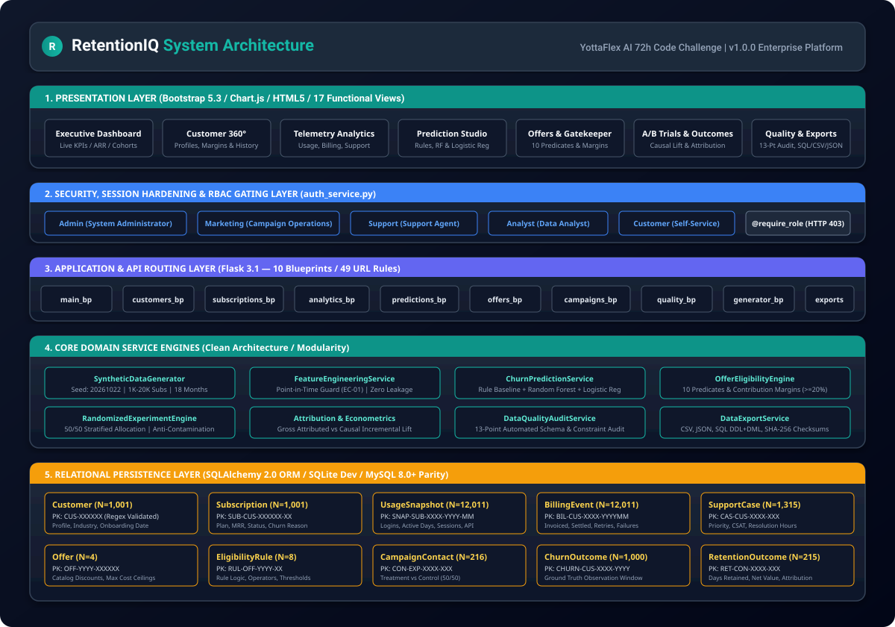

# RETENTIONIQ — System Architecture & Technical Specifications

**Version:** 1.0.0
**Project:** AI-Powered Customer Churn Prediction & Retention Optimization Platform
**Target RDBMS:** SQLite (Local Dev) / MySQL 8.0+ (Enterprise Compatibility)

---

## 1. Architectural Overview

RetentionIQ is an end-to-end customer intelligence and randomized experimentation platform designed to identify subscribers vulnerable to churn, validate promotional incentives against unit financial margins, conduct randomized controlled trials (A/B testing), and measure incremental retention lift.

*(Vector diagram file available in [`architecture_diagram.svg`](architecture_diagram.svg))*

```mermaid
flowchart TD
    subgraph UI["Presentation Layer (Bootstrap 5 / Chart.js / HTML5)"]
        D1["Executive Dashboard"]
        D2["Customer 360° Profile"]
        D3["Risk & Explainability Studio"]
        D4["Telemetry Analytics (Usage / Billing / Support)"]
        D5["Offer & Margin Gatekeeper"]
        D6["A/B Experiment Studio"]
        D7["Data Quality Suite"]
    end

    subgraph API["Application & API Layer (Flask 3.1)"]
        R1["main_bp (/)"]
        R2["customers_bp (/customers)"]
        R3["predictions_bp (/predictions)"]
        R4["analytics_bp (/usage, /billing, /support)"]
        R5["offers_bp (/offers, /eligibility)"]
        R6["campaigns_bp (/campaigns, /experiments, /outcomes)"]
        R7["quality_bp (/quality)"]
        R8["generator_bp (/generator)"]
        R9["exports_bp (/exports)"]
    end

    subgraph Services["Core Domain Service Engines"]
        S1["SyntheticDataGenerator (Seed: 20261022)"]
        S2["FeatureEngineeringService (Point-in-Time Temporal Guard)"]
        S3["ChurnPredictionService (Weighted Heuristics + Supervised ML)"]
        S4["OfferEligibilityEngine (10-Point Gatekeeper & Margins)"]
        S5["RandomizedExperimentEngine (Stratified 50/50 Allocation)"]
        S6["DataQualityAuditService (13-Point Relational Integrity)"]
        S7["DataExportService (CSV, JSON, SQL DDL+DML, SHA-256)"]
    end

    subgraph Data["Persistence Layer (SQLAlchemy 2.0 ORM)"]
        M1["Customer"]
        M2["Subscription"]
        M3["UsageSnapshot"]
        M4["BillingEvent"]
        M5["SupportCase"]
        M6["Offer"]
        M7["EligibilityRule"]
        M8["CampaignContact"]
        M9["ChurnOutcome (Ground Truth)"]
        M10["RetentionOutcome"]
    end

    UI --> API
    API --> Services
    Services --> Data
```

---

## 2. Layer Responsibilities

### 2.1 Presentation Layer
- **Responsive Theme:** Modern Navy (`#0F172A`) and Teal (`#0D9488` / `#14B8A6`) enterprise SaaS aesthetic.
- **Client-Side Dynamics:** Instant table filtering across thousands of rows without server roundtrips.
- **Interactive Visualizations:** Chart.js powered line charts (cohort retention, active days), doughnut charts (churn status, risk distribution), and bar charts (API volume).
- **17 Functional Views:**
  1. Executive Dashboard (`/`)
  2. Customer Directory (`/customers/`)
  3. Customer 360° Detail (`/customers/<id>`)
  4. Churn Risk & Explainability (`/predictions/`)
  5. Subscription Management (`/subscriptions/`)
  6. Usage Analytics (`/usage`)
  7. Billing Analytics (`/billing`)
  8. Support Analytics (`/support`)
  9. Retention Offer Catalog (`/offers`)
  10. Eligibility & Margin Gatekeeper (`/eligibility`)
  11. Campaign Management (`/campaigns`)
  12. A/B Experiment Studio (`/experiments`)
  13. Retention Outcomes & Attribution (`/outcomes`)
  14. Data Quality & Anomaly Suite (`/quality/`)
  15. Synthetic Data Generator (`/generator/`)
  16. Data Exports & Reproducibility (`/exports/`)
  17. System Documentation (`/docs`)

### 2.2 Application & Routing Layer
- Structured Flask blueprints modularized by domain.
- REST API endpoints providing JSON payloads for headless automation.
- Scoped database session lifecycle management via `teardown_appcontext`, eliminating `DetachedInstanceError`.
- Comprehensive HTTP status codes and error handling.

### 2.3 Core Domain Service Engines
- **SyntheticDataGenerator:** High-performance, parent-first procedural generator creating 10 relational entities across 18 calendar months with fixed seed `20261022`.
- **FeatureEngineeringService:** Implements zero-temporal-leakage feature calculation strictly masking records timestamped after prediction cutoff $T_{pred}$.
- **ChurnPredictionService:** Transparent weighted scoring baseline coupled with Random Forest / Logistic Regression supervised classifiers evaluated on holdout windows.
- **OfferEligibilityEngine:** Pre-flight gatekeeper validating 10 business rules and unit contribution margin thresholds prior to offer dispatch.
- **RandomizedExperimentEngine:** Freezes candidate populations, executes stratified 50/50 treatment vs control randomization, and prevents cross-arm contamination.
- **DataQualityAuditService:** Executes 13 automated integrity checks on primary keys, foreign keys, timestamps, enums, monetary math, and edge cases.
- **DataExportService:** Generates reproducible CSV, JSON, and ANSI SQL dumps accompanied by cryptographic SHA-256 manifests.

### 2.4 Data & Persistence Layer
- 10 distinct entities modeled via SQLAlchemy 2.0 DeclarativeBase.
- Strict deterministic ID formatting enforced through compiled regex validators (`CUS-000001`, `SUB-CUS-000001-01`, etc.).
- SQLite foreign key enforcement enabled via `PRAGMA foreign_keys = ON` connection listeners.
- MySQL 8.0+ compatibility preserved across all datatypes and constraints.
